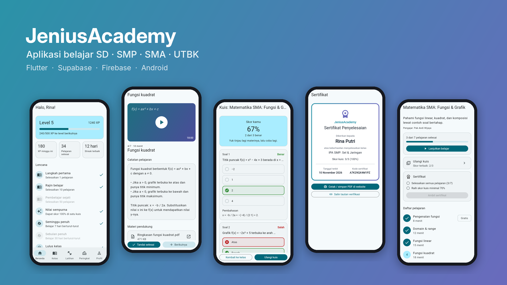

# JeniusAcademy — Aplikasi Android (Flutter)

Aplikasi siswa JeniusAcademy. Memakai **Supabase yang sama** dengan website, jadi akun,
progres, XP, dan aturan akses (RLS) sama persis. Rencana lengkap: [`docs/MOBILE_PLAN.md`](../docs/MOBILE_PLAN.md).

- Package name: **`com.jeniusacademy.app`** (jangan diubah setelah dibagikan)
- Flutter 3.50 (stable), Riverpod, go_router, supabase_flutter, Firebase Cloud Messaging
- Versi gratis: Tutor AI dimatikan (`AppConfig.tutorAi` di `lib/core/config.dart`)

## Yang sudah ada

| Layar | Isi |
|---|---|
| Masuk / Daftar / Lupa sandi | Login email + kata sandi Supabase. Tautan email (konfirmasi, reset sandi) dibuka di website. |
| Beranda | Level & XP, XP minggu ini, pelajaran selesai, streak terbaik, 10 lencana (RPC `my_achievements`) |
| Kelas | Katalog kelas terbit + filter jenjang; detail kelas dengan progres, tombol "Lanjutkan belajar", tanda pelajaran selesai |
| Pelajaran | Video YouTube, catatan, materi (dibuka lewat tautan sementara 1 jam), tandai selesai, pelajaran berikutnya. Tanpa hak akses: layar "khusus pelanggan" — video & catatan tidak dikirim database |
| Kuis | Soal tanpa kunci; dinilai di server (`submit_quiz`), lalu benar/salah, kunci & pembahasan per soal; skor terbaik di detail kelas |
| Sertifikat | Syarat (semua pelajaran + kuis ≥ 70%), ambil lewat `claim_certificate`, tampilan sertifikat, cetak/PDF & tautan verifikasi di website, daftar di Profil |
| Peringkat | Leaderboard mingguan / sepanjang waktu (RPC `xp_leaderboard`) |
| Latihan | Latihan pintar: soal kuis yang salah diulang terjadwal (1-2-4-7-14 hari), dinilai server |
| Try-out UTBK | Katalog, subtes bertimer (waktu dari server), simpan otomatis, serahkan otomatis, hasil, pembahasan, peringkat |
| Diskusi | Tanya jawab per pelajaran, balasan, label pengajar, hapus |
| Kelas live | Jadwal, tombol masuk dari server (15 menit sebelum), Google Calendar, rekaman |
| Kelas sekolah | Gabung dengan kode, tugas & tenggat, status dari server |
| Tutor AI | Tanya AI per pelajaran & "Jelaskan dengan AI" di kuis — **mati** (`AppConfig.tutorAi`) karena berbayar |
| Offline | Katalog & catatan pelajaran tersimpan, progres antre lalu terkirim, unduh materi PDF, pita "offline"; dihapus saat keluar |
| Widget | Widget layar utama Android: streak, level & XP minggu ini (StreakWidgetProvider.kt) |
| Notifikasi | Izin saat login, token didaftarkan & dihapus saat keluar, pengingat harian 19.00 WIB, ketuk → Beranda |
| Profil | Ubah nama & foto (galeri, diperkecil 512 px, bucket `avatars`), target mingguan, tampil/sembunyi di peringkat, daftar sertifikat, bahasa ID/EN (tersimpan di perangkat), keluar |
| Latihan | "Segera hadir" |



Screenshot per layar ada di [`screenshots/`](screenshots/) (data contoh, bukan data asli).

## Menjalankan di laptop

1. Pasang **Flutter SDK** (stable) dan **Android Studio** — https://docs.flutter.dev/get-started/install
2. Salin konfigurasi lalu isi (nilai sama dengan `.env` website):
   ```bash
   cd mobile
   cp env.example.json env.json
   ```
   | Kunci | Isi |
   |---|---|
   | `SUPABASE_URL` | = `NEXT_PUBLIC_SUPABASE_URL` |
   | `SUPABASE_PUBLISHABLE_KEY` | = `NEXT_PUBLIC_SUPABASE_PUBLISHABLE_KEY` |
   | `SITE_URL` | alamat website (untuk tautan di email), mis. `https://jeniusacademy.vercel.app` |
3. Sambungkan HP Android (aktifkan *USB debugging*) atau buka emulator, lalu:
   ```bash
   flutter pub get
   flutter run --dart-define-from-file=env.json
   ```

Tes & pemeriksaan: `flutter analyze` dan `flutter test`.

### Mode demo (data contoh, tanpa Supabase)

Untuk presentasi atau screenshot portofolio, jalankan dengan data contoh dari
`lib/demo/demo_data.dart` (tanpa login dan tanpa `env.json`):

```bash
flutter run -t lib/demo/main_demo.dart
```

## Login Google (opsional)

Tombol "Lanjutkan dengan Google" baru muncul setelah dikonfigurasi:

1. Google Cloud Console (project yang sama dengan Firebase) → APIs & Services → Credentials:
   - **OAuth client ID tipe Web** → salin Client ID & secret ke Supabase → Authentication →
     Providers → Google (aktifkan).
   - **OAuth client ID tipe Android**: package `com.jeniusacademy.app` + SHA-1 kunci tanda
     tangan APK (`keytool -list -v -keystore <keystore>`; untuk build GitHub tanpa keystore,
     SHA-1-nya berubah tiap runner, jadi siapkan keystore dulu).
2. Isi `GOOGLE_WEB_CLIENT_ID` (Client ID **Web**, bukan Android) di `env.json` dan di GitHub →
   Actions → Variables.

## Push notification (pengingat belajar harian)

Alur: login → aplikasi minta izin notifikasi → token FCM disimpan lewat RPC
`register_device_token` (tabel `device_tokens`, migration `20261121000000_device_tokens.sql`)
→ setiap hari 19.00 WIB cron `src/app/api/cron/daily-reminder` mengirim ke siswa yang belum
belajar hari ini (`device_reminder_targets`). Keluar → token perangkat dihapus dulu.
Mengetuk notifikasi membuka Beranda.

Yang perlu disiapkan:

1. `mobile/android/app/google-services.json` — sudah ada (project `jeniusacademymobile`).
2. **Merge ke `main`** agar migration diterapkan otomatis oleh CI.
3. Vercel → Settings → Environment Variables: **`FIREBASE_SERVICE_ACCOUNT`** = isi lengkap
   file JSON dari Firebase Console → Project settings → Service accounts →
   *Generate new private key*. **Rahasia** — jangan di-commit, jangan dikirim lewat chat.
   (`CRON_SECRET` dan `SUPABASE_SECRET_KEY` juga harus sudah diisi.)

Tanpa langkah 2–3 aplikasi tetap jalan normal; pengingat saja yang tidak terkirim.

## Membuat APK

### Kunci tanda tangan (sekali saja)

APK versi baru hanya bisa dipasang **menimpa** versi lama jika ditandatangani kunci yang sama.
Buat sekali, simpan cadangannya baik-baik (hilang = pengguna harus uninstall dulu):

```bash
keytool -genkey -v -keystore ~/jeniusacademy-upload.jks -keyalg RSA -keysize 2048 \
  -validity 10000 -alias upload
```

Lalu buat `mobile/android/key.properties` (**jangan di-commit**, sudah di `.gitignore`):

```properties
storeFile=/home/anda/jeniusacademy-upload.jks
storePassword=PASSWORD_ANDA
keyAlias=upload
keyPassword=PASSWORD_ANDA
```

Tanpa `key.properties`, build release memakai kunci debug (boleh untuk coba-coba).

### Build di laptop

```bash
flutter build apk --release --dart-define-from-file=env.json
# hasil: build/app/outputs/flutter-apk/app-release.apk
```

### Build otomatis di GitHub (gratis, tanpa laptop)

Workflow `.github/workflows/mobile.yml` menjalankan analyze, test, dan build APK setiap ada
perubahan di `mobile/`. APK bisa diunduh di tab **Actions → run terbaru → Artifacts → jeniusacademy-apk**.

Isi di GitHub → Settings → Secrets and variables → Actions:

| Jenis | Nama | Isi |
|---|---|---|
| Variable | `SUPABASE_URL` | URL Supabase |
| Variable | `SUPABASE_PUBLISHABLE_KEY` | publishable key Supabase |
| Variable | `SITE_URL` | alamat website |
| Secret | `ANDROID_KEYSTORE_BASE64` | isi keystore: `base64 -w0 jeniusacademy-upload.jks` |
| Secret | `ANDROID_KEYSTORE_PASSWORD` | password keystore |
| Secret | `ANDROID_KEY_ALIAS` | `upload` |
| Secret | `ANDROID_KEY_PASSWORD` | password kunci |

Tanpa variabel Supabase, APK tetap jadi tetapi hanya menampilkan "Aplikasi belum dikonfigurasi".

### Membagikan ke penguji

- **Firebase App Distribution** (gratis): Firebase Console → App Distribution → unggah APK → undang email penguji.
- Atau kirim file APK langsung (penguji mengizinkan "Instal dari sumber tidak dikenal").

## Struktur

```
lib/
  main.dart, app.dart     titik masuk, tema, bahasa, router
  core/                   config (padanan site.ts), env, theme, router, providers, services
  data/                   akses Supabase: auth, kelas, XP/leaderboard
  domain/                 fungsi murni, port dari src/lib (gamification, teks multibahasa)
  features/               satu folder per layar
  l10n/                   app_id.arb, app_en.arb (teks antarmuka)
  widgets/                komponen bersama
test/                     tes; domain/ memakai ../shared/fixtures (sama dengan tes website)
```

**Aturan:** logika yang juga ada di website ditulis ulang di `lib/domain/` dan diuji dengan
kasus yang sama di `shared/fixtures/*.json`, supaya hasil web dan aplikasi tidak berbeda.
Aturan yang penting bagi keamanan (penilaian kuis, akses berbayar, sertifikat) tetap di database.
